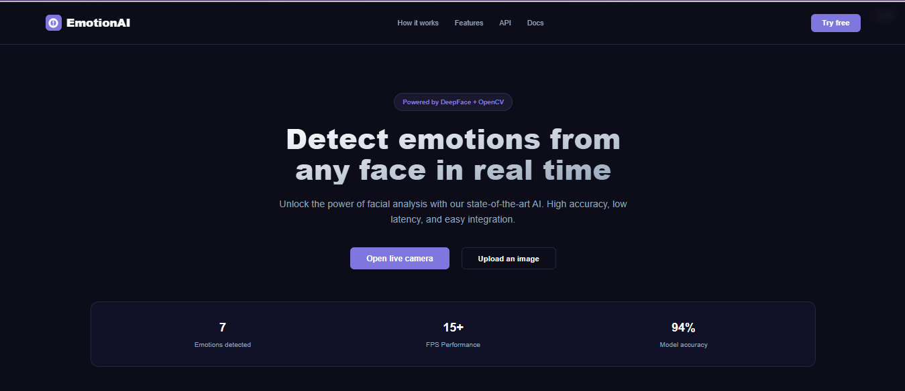
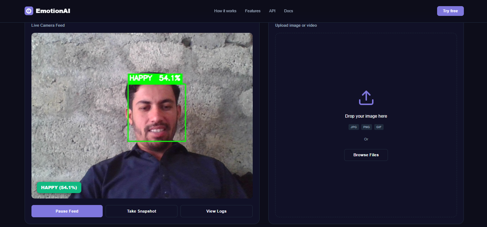
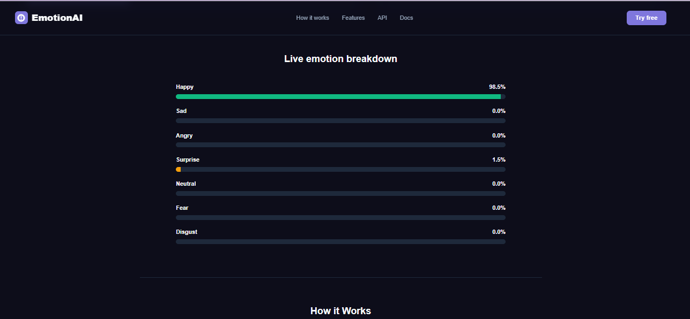

# EmotionAI — Real-time Facial Emotion Recognition

[](https://github.com/jalalakbar47/facial-emotion-recognition/search?l=html)
[](https://github.com/jalalakbar47/facial-emotion-recognition/stargazers)
[](https://github.com/jalalakbar47/facial-emotion-recognition/network/members)
[](https://github.com/jalalakbar47/facial-emotion-recognition/issues)
[](https://github.com/jalalakbar47/facial-emotion-recognition/commits/main)

A high-performance facial emotion recognition dashboard built with **DeepFace**, **OpenCV**, and **Flask**. Features a premium dark-mode UI with real-time camera streaming, image upload analysis, and live emotion breakdown charts.

## 📸 Screenshots

*Dashboard overview showing live feed and emotion analytics.*


*Static image analysis with detailed emotion breakdown.*


*Live emotion breakdown bars responding in real-time.*

## 🚀 Features
- **Real-time Live Feed**: Zero-lag camera processing with background threading.
- **Image Uploads**: Instant analysis for static images with automatic camera hand-off.
- **7-Emotion Analysis**: Detects Happy, Sad, Angry, Surprise, Neutral, Fear, and Disgust.
- **Modern UI**: Glassmorphism dashboard with smooth animations and responsive design.
- **Multi-face Support**: Capable of analyzing multiple faces simultaneously.

## 🛠️ Installation

1. **Clone the repository**:
   ```bash
   git clone https://github.com/jalalakbar47/facial-emotion-recognition.git
   cd facial-emotion-recognition
   ```

2. **Create a virtual environment**:
   ```bash
   python -m venv venv
   source venv/bin/activate  # On Windows: .\venv\Scripts\activate
   ```

3. **Install dependencies**:
   ```bash
   pip install -r requirements.txt
   ```

4. **Run the application**:
   ```bash
   python web/app.py
   ```
   Visit `http://localhost:5000` in your browser.

## 👨‍💻 Author & Dedication
Created with ❤️ by [jalalakbar47](https://github.com/jalalakbar47)

> **Dedicated To My ❤️ J/S — My Inspiration.**
